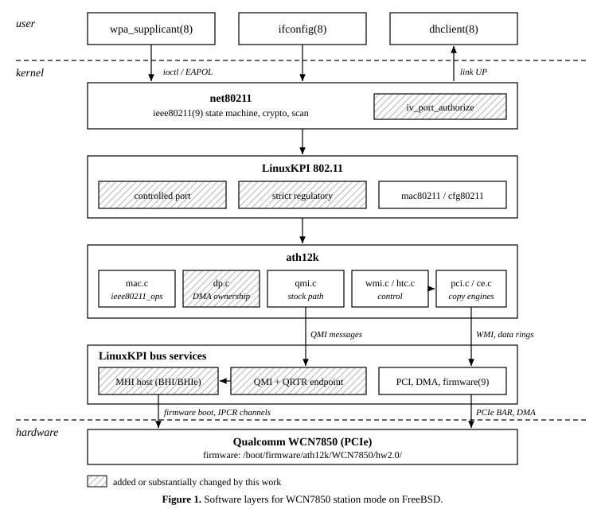

# freebsd-ath12k-wcn7850

Patches that make the Qualcomm WCN7850 Wi-Fi card work in station mode
on FreeBSD, using the in-tree ath12k driver (`sys/contrib/dev/athk/ath12k`)
through LinuxKPI.

**Status:** WPA2-PSK station mode works on 2.4 GHz (20 MHz) and 5 GHz
(HT40/VHT80) on FreeBSD 15.1, tested on a Lenovo ThinkPad T14s Gen 6,
with unattended bring-up at boot, DHCP and ping. See the
[test results](results/2026-10-27/README.md).

The hardware runs used the previous revision of the stable/15 series.
The current revision adds style, module-dependency, debugfs-build and
manual page changes, and has been build-tested.



More diagrams are in [docs/figures](docs/figures/).

## How this was made, and what I am asking

I am a long-time FreeBSD user, not a kernel developer. Most of this
code was written with an AI coding assistant (GitHub Copilot) under my
direction, and I ran all of the hardware tests. Please treat it as a
working proof of concept and a reference, not as commit-ready code. I
would welcome feedback, review of the design questions in
[DEVELOPER-NOTES.md](DEVELOPER-NOTES.md), and testing on other
hardware.

## What's here

| Path | Contents |
|------|----------|
| `patches/stable-15/` | 0001-0010 against `stable/15` at `169e254b` (tested on hardware) |
| `patches/main/` | The same 10 patches against `main` at `91bff7d7ed4` (build-tested only) |
| `patches/local/` | 0011-0014, not for upstream: kernel configs, test harnesses, Kyua hookup, rc.d script |
| `patches/linuxkpi-txq-leak/` | Independent LinuxKPI 802.11 fix: free per-TID txqs in `lkpi_lsta_free()` |
| `docs/ath12k.4.txt` | The ath12k(4) manual page, rendered as text |
| `docs/figures/` | Architecture and sequence diagrams |
| `tools/` | `ath12k_wlan.rc` (rc.d script), `plot-results.pl` (CSV to SVG) |
| `results/` | Hardware test results, charts, raw data and a boot dmesg |
| `DEVELOPER-NOTES.md` | Test detail, patch split, design questions, known limitations |

Changes to vendor code under `sys/contrib/dev/athk` are wrapped in
`#if defined(__FreeBSD__)`, with the Linux code kept under `#else`.
QMI and the MHI host are implemented in LinuxKPI, so ath12k keeps its
stock `qmi_handle_init()` path. `if_ath12k.ko` is not yet hooked into
`sys/modules/Makefile`.

## Quick start (stable/15)

```sh
git clone https://github.com/freebsd/freebsd-src.git && cd freebsd-src
git checkout -b ath12k-wcn7850 169e254b8440c010139b1351f46b70bc7ad3d5cb
git am /path/to/freebsd-ath12k-wcn7850/patches/stable-15/*.patch
git am /path/to/freebsd-ath12k-wcn7850/patches/local/*.patch   # optional

make buildkernel KERNCONF=GENERIC
make installkernel KERNCONF=GENERIC KODIR=/boot/kernel.ath12k
```

For `main`, check out `91bff7d7ed461360bc992dcd411703db6cd6d2a1` and
apply `patches/main/*.patch` instead.

The txq leak fix is recommended if you unload and reload the driver. It
applies on its own to either base:

```sh
git am /path/to/freebsd-ath12k-wcn7850/patches/linuxkpi-txq-leak/*.patch
```

### Firmware

Install the firmware package with `fwget` or
`pkg install wifi-firmware-ath12k-kmod-wcn7850_hw20`. It installs plain
image files under `/boot/firmware/ath12k/WCN7850/hw2.0/`, and the driver
reads them through firmware(9) when it attaches. **No firmware kernel
module needs to be loaded.** Do not add one to `kld_list`: devmatch(8)
loads `if_ath12k` early, the images are already registered, and the
module then fails with `already registered` / `error 6`.

### Regulatory

Set the country in loader.conf(5):

```
hw.ath12k.country="CA"   # ISO 3166 alpha-2
```

### Bring-up at boot

Install `tools/ath12k_wlan.rc` as `/usr/local/etc/rc.d/ath12k_wlan` and
set `ath12k_wlan_enable="YES"` in rc.conf(5). It creates `wlan0`, which
`wlans_ath12k_wifi70` cannot do (see the manual page CAVEATS). With
`ath12k_wlan_dhcp="YES"` (the default), dhclient(8) is started by a
`wpa_cli -a` action script on association, so late associations still
get a lease.

Do not leave backup copies in `rc.d`: rc(8) runs every file there except
`*.bak`, `*.orig`, `*.OLD`, `*~` and `*,v`.

## Manual page

Patch 0008 adds ath12k(4) and lists the driver in linuxkpi_wlan(4). It
covers loading, firmware, the `hw.ath12k.country` tunable, caveats and
current limits.

- Read it without a source tree: [docs/ath12k.4.txt](docs/ath12k.4.txt)
- From a patched source tree: `man -l share/man/man4/ath12k.4`

Like ath10k.4, it is not yet listed in `share/man/man4/Makefile`, so
`installworld` does not install it.

## Boot messages

Driver attach, from the full [dmesg.boot](results/2026-10-27/dmesg.boot):

```
ath12k_wifi70: <ath12k_wifi7> mem 0xb0600000-0xb07fffff at device 0.0 on pci2
ath12k_wifi70: Wi-Fi 7 Hardware name: wcn7850 hw2.0
ath12k_wifi70: MSI vectors: 16
kldload: /boot/firmware/ath12k/WCN7850/hw2.0/amss.bin: Unsupported file layout
kldload: /boot/firmware/ath12k/WCN7850/hw2.0/amss.bin: Unsupported file layout
ath12k_wifi70: successfully loaded firmware image 'ath12k/WCN7850/hw2.0/amss.bin'
ath12k_wifi70: chip_id 0x2 chip_family 0x4 board_id 0xff soc_id 0x40170200
ath12k_wifi70: fw_version 0x1103006c fw_build_timestamp 2026-03-06 09:10 fw_build_id QC_IMAGE_VERSION_STRING=WLAN.HMT.1.1.c7-00108-QCAHMTSWPL_V1.0_V2.0_SILICONZ_UPSTREAM-3ath12k_wifi70: successfully loaded firmware image 'ath12k/WCN7850/hw2.0/board-2.bin'
ath12k_wifi70: successfully loaded firmware image 'ath12k/WCN7850/hw2.0/board-2.bin'
ath12k_wifi70: successfully loaded firmware image 'ath12k/WCN7850/hw2.0/board-2.bin'
kldload: /boot/firmware/ath12k/WCN7850/hw2.0/m3.bin: Unsupported file layout
kldload: /boot/firmware/ath12k/WCN7850/hw2.0/m3.bin: Unsupported file layout
ath12k_wifi70: successfully loaded firmware image 'ath12k/WCN7850/hw2.0/m3.bin'
...
wlan0: Ethernet address: xx:xx:xx:xx:xx:01
wlan0: link state changed to DOWN
wlan0: link state changed to UP
```

- `kldload: ... Unsupported file layout` is harmless: firmware(9) tries
  each image as a kernel module before reading it as a plain file.
- The `fw_build_id` message is missing its newline, so the next message
  is joined to it. This is a cosmetic bug.

## Known issues

- After each unload/reload, `idr`, `taskqueue` and `lkpikmalloc` still
  grow slightly. The source is not yet known.
- In one of four delayed-association tests, traffic did not resume after
  reconnect until the service was restarted. That run overlapped with
  `lkpi_regulatory_test` loads, which register a second LinuxKPI 802.11
  device. Run the Kyua kernel tests on a machine that is not using Wi-Fi.
- Not supported or not tested: 6 GHz, 160 MHz, 2.4 GHz 40 MHz,
  WPA3/SAE/PMF, suspend/resume. Tested with one host, one card and
  essentially one access point.

The full list is in [DEVELOPER-NOTES.md](DEVELOPER-NOTES.md).

## License

This repository is BSD-2-Clause ([LICENSE](LICENSE)). Files touched by
the patches keep their SPDX license:

| Area | License |
|---|---|
| `sys/contrib/dev/athk` (ath12k, plus small ath10k/ath11k changes; new `dp_cc.h`) | BSD-3-Clause-Clear |
| `sys/compat/linuxkpi` (new MHI/QMI code), `sys/net80211`, `ath12k.4`, `tests/`, `tools/` | BSD-2-Clause |
| `sys/tests/linuxkpi_wlan` (local only) | BSD-2-Clause, or BSD-3-Clause-Clear where ath12k tables are reused |

No GPL code was intentionally used. The Linux MHI and QMI code is
GPL-2.0, so the LinuxKPI versions were written against the Linux header
interfaces (`linux/mhi.h`, `linux/soc/qcom/qmi.h`), not ported. OpenBSD
qwz(4) was consulted for the WCN7850 MHI boot sequence, not copied. A
line comparison against those sources (2026-10-27) found no shared lines
beyond `#include` lines and Linux API calls; this rules out verbatim
copying, not paraphrase.

**AI assistance:** most of this code was written with an AI coding
assistant (GitHub Copilot) under my direction, and I share it under
the licenses above. The FreeBSD Project has not yet published a
policy on AI-assisted contributions; I will follow it once it
exists.
