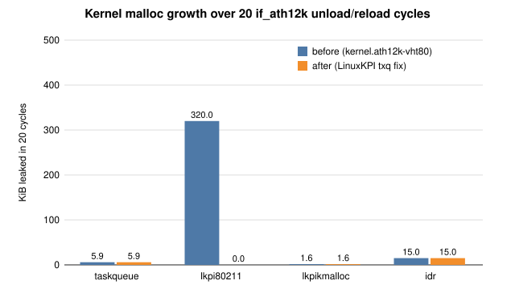
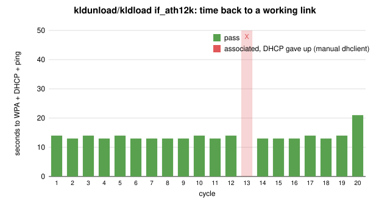
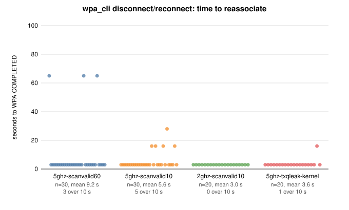
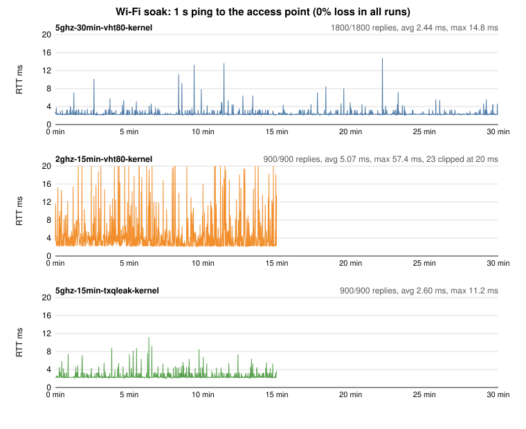
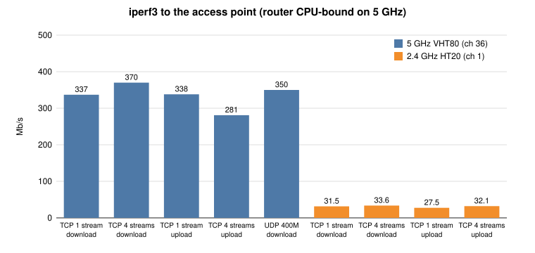

# WCN7850 (ath12k) test results, 2026-10-26/27

These are hardware results for the series in `patches/`, plus the separate LinuxKPI txq leak fix in `patches/linuxkpi-txq-leak/`. Raw data is in [`data/`](data). Regenerate the charts with `perl tools/plot-results.pl results/2026-10-27` (core Perl only).

## Setup

| | |
|---|---|
| Host | FreeBSD 15.1-STABLE amd64, Qualcomm WCN7850 hw2.0, firmware WLAN.HMT.1.1.c7-00108 |
| Kernels | `kernel.ath12k-vht80` (`stable-15` 0001-0008 + `local`), `kernel.ath12k-txqleak` (the same + the LinuxKPI txq fix) |
| Access point | GL.iNet GL-MT3000 (MT7981, OpenWrt 21.02 GL firmware), WPA2-PSK CCMP |
| Links | 5 GHz channel 36, VHT80, 2 spatial streams. 2.4 GHz channel 1, HT20 |
| Station config | `tools/ath12k_wlan.rc` with `ath12k_wlan_args="scanvalid 10"` |

## Summary

| Test | Result |
|------|--------|
| Unload/reload, kernel malloc growth | `lkpi80211`: 320 KiB per 20 cycles before the fix, **0 after** |
| Unload/reload, link recovery | 20/20 unloads clean, no WMI timeouts; 19/20 back up unattended in 13-21 s (see known issues) |
| Hot unload while associated (earlier run) | 10/10 pass |
| Reconnect, 5 GHz, txq-fix kernel | 20/20, mean 3.65 s (19 x 3 s, 1 x 16 s) |
| Reconnect, 2.4 GHz, `scanvalid 10` | 20/20, all 3 s |
| Soak, 5 GHz, 30 min | 1800/1800 replies, avg 2.44 ms, max 14.8 ms |
| Soak, 5 GHz, 15 min, txq-fix kernel | 900/900 replies, avg 2.60 ms, max 11.2 ms, no malloc growth |
| Soak, 2.4 GHz, 15 min | 900/900 replies, avg 5.07 ms, max 57.4 ms |
| iperf3, 5 GHz VHT80 | TCP down 337 Mb/s (370 with 4 streams), up 338 Mb/s; UDP down 350 Mb/s at 0% loss |
| iperf3, 2.4 GHz HT20 | 28-34 Mb/s each way |
| Build, LinuxKPI txq fix alone | GENERIC + linuxkpi, linuxkpi_wlan, wlan, ath10k, iwlwifi, rtw88, rtw89, mt76: no errors, no warnings on `stable/15` 169e254b and `main` 91bff7d7 |

## Boot messages

[`dmesg.boot`](dmesg.boot) is `/var/run/dmesg.boot` from the `kernel.ath12k-txqleak` kernel (`ATH12KHOST` config, which enables WITNESS). MAC addresses, the build host and the NVMe serial number are redacted; nothing else is changed. The `kldload: ... Unsupported file layout` lines are firmware(9) probing each raw image as a KLD before reading it as a file, and are harmless. The `fw_build_id` line has no trailing newline in the driver output, so the next message starts on the same line.

## Kernel memory over driver unload/reload

`vmstat -m` was taken before and after 20 cycles of `service ath12k_wlan stop`, `kldunload if_ath12k`, `kldload` and reassociation. Without the fix, `lkpi_lsta_free()` leaks the station's per-TID `lkpi_txq` allocations: 64 allocations (16 KiB) per cycle. With the fix, `lkpi80211` is unchanged. The remaining growth (`idr` 768 B, `taskqueue` 304 B, `lkpikmalloc` 80 B per cycle) is not yet attributed. Reconnect cycles and the 15-minute soak showed no growth in any of these four types.

## Reconnect time

Each cycle runs `wpa_cli disconnect` and `wpa_cli reconnect`, then times how long until `wpa_state=COMPLETED`. With the net80211 default `scanvalid 60`, the GL access point sometimes did not answer the first probe after deleting the station. net80211 then answered wpa_supplicant's rescans from its cache for 60 s, giving ~65 s stalls. `scanvalid 10` bounds this to 16-28 s. This is not an ath12k issue.

## Soak

The soak sends one ping per second from the wlan0 address to the access point. Link state was sampled every minute and was always `COMPLETED`/`associated`. The only kernel messages were `Received with invalid mcs in VHT mode 10/11`: the MT7981 access point sends non-standard VHT MCS 10/11, and the warning is rate-limited to once per second, as in Linux.

## Throughput

The iperf3 server ran on the access point. On 5 GHz the router's CPU was saturated (one core in softirq), while the station was 99% idle. These numbers are therefore an access-point limit, not the WLAN ceiling. UDP upload at 600 Mb/s offered reached 336 Mb/s at the router.

## Known issues

- After one unload/reload cycle, wpa_supplicant reached `COMPLETED` on 2.4 GHz only after `dhclient -b` had already given up (`no link ... giving up`). wlan0 stayed without an address until `dhclient wlan0` was run. This is a timing problem in the local `ath12k_wlan` rc script, not in the driver.
- About 30% of `wpa_cli disconnect` cycles leave no DIS-ASSOC entry in the access point's log. It did not reproduce with LinuxKPI TX tracing on (6/6 frames ACKed). Reconnection is unaffected.
- `mac sta rc update failed to fetch link sta` was logged 3 times during the 20 unload cycles, with no functional effect.
- Not tested or not supported: 6 GHz, WPA3/SAE/PMF (net80211 and wpa_supplicant `driver_bsd`), suspend/resume (the host has no S3), 2.4 GHz 40 MHz, 160 MHz.
